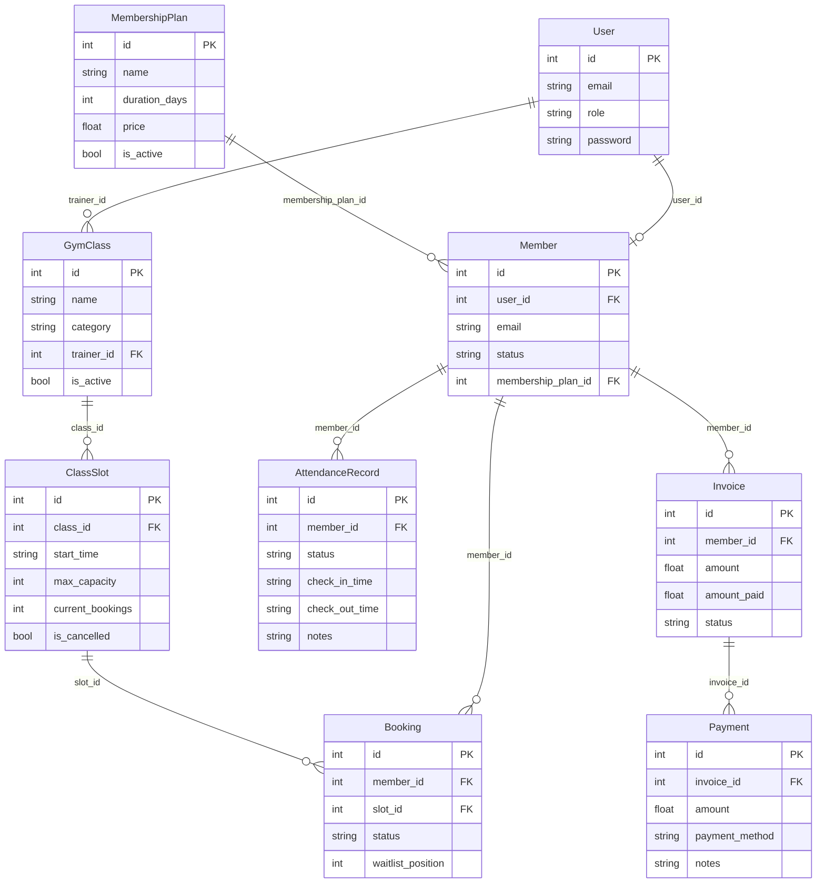

# Gym Management System — Project Architecture & Context

## 1. Project Overview
A modular monolith gym management system built with **FastAPI**, **SQLAlchemy 2.0** (`Mapped`, `mapped_column`, `MappedAsDataclass`), and persistent storage in **SQLite** (`./gym.db`).
The system consolidates 9 business domains into a single high-performance application running on port `8000`.

---

## 2. Architecture Layers

The system follows a strict layered pattern across 9 business domains:

1. **`app/models/` (SQLAlchemy 2.0 Declarative Models)**: Entity classes inheriting from a shared `Base(MappedAsDataclass, DeclarativeBase, kw_only=True)` with typed `Mapped[...]` attributes, primary keys (`mapped_column(primary_key=True)`), and foreign key relations (`ForeignKey(...)`).
2. **`app/schemas/` (Validation & DTOs)**: Pure Pydantic V2 request/response models (`*Request`, `*Response`) with strict boundary validations (`gt`, `lt`, `min_length`, `max_length`), `model_config = ConfigDict(from_attributes=True, json_schema_extra={...})` for seamless ORM serialization and OpenAPI documentation.
3. **`app/database/` (SQLite Session & Seeder)**:
   - `session.py`: Creates `engine` pointing to `sqlite:///gym.db` (configurable via `DATABASE_URL`), provides `create_db_and_tables()` via `Base.metadata.create_all(engine)` and `get_session()` FastAPI generator dependency returning `sqlalchemy.orm.Session`.
   - `seed.py`: Contains idempotent `seed_database(session)` function with standard mock dataset using pure SQLAlchemy `select` and `session.scalars()`.
4. **`app/routers/` (FastAPI APIRouters)**: 9 REST APIRouters injecting `session: Session = Depends(get_session)` executing type-safe SQLAlchemy queries (`select(...)`, `session.scalars()`, `session.get()`, `session.add()`, `session.commit()`, `session.delete()`).
5. **`app/main.py` & `run.py` & `seed.py`**:
   - `app/main.py`: Central application setup registering all 9 routers with tags and prefixes, plus a FastAPI `lifespan` handler executing `create_db_and_tables()`.
   - `run.py`: Lightweight application launcher.
   - `seed.py`: Standalone CLI script for database initialization and seeding.

---

## 3. Data Model Relationships



---

## 4. Domain Workflows

1. **Member Onboarding (`/members`)**:
   - Validates existence of referenced `user_id` and optional `membership_plan_id` via `session.get()`.
   - Prevents orphan member profiles (returns 400 Bad Request on invalid keys).

2. **Class Scheduling & Waitlists (`/bookings`)**:
   - Ensures member status is `active`.
   - Checks slot cancellation status (`is_cancelled`) and capacity.
   - If slot is open (`current_bookings < max_capacity`), increments slot count and marks booking as `confirmed`.
   - If slot is full, queries existing waitlisted entries and marks booking as `waitlisted` with sequential queue position without altering capacity.

3. **Billing Settlement (`/payments`)**:
   - Validates invoice existence and verifies that invoice is not already `paid`.
   - Creates payment record, increments `invoice.amount_paid`, and transitions `invoice.status` to `"paid"` upon full settlement.

---

## 5. Development & Testing Commands

```bash
# Seed initial sample data to gym.db
python seed.py

# Run application
python run.py

# Run isolated in-memory test suites
pytest tests/ -v
```
