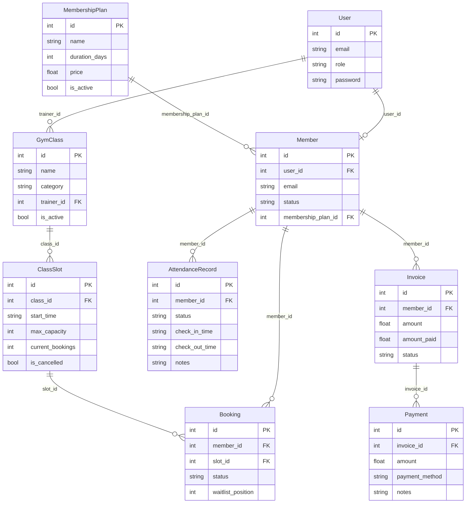

# Gym Management System — Project Architecture & Context

## 1. Project Overview
A modular monolith gym management system built with **FastAPI** and **Pydantic V2**. 
Originally designed as individual microservices, the system has been refactored into a clean, layered **Modular Monolith** running within a single FastAPI process on port `8000`.

---

## 2. Architecture Layers

The system follows a strict layered pattern across 9 business domains:

1. **`app/models/` (Domain Entities)**: Pure Python classes representing core entities with standard constructors (`__init__`).
2. **`app/schemas/` (Validation & DTOs)**: Pydantic V2 models with strict boundary validations (`gt`, `lt`, `min_length`, `max_length`), and `model_config = ConfigDict(json_schema_extra={...})` for OpenAPI documentation.
3. **`app/database/` (Centralized In-Memory Store)**: `db.py` contains in-memory stores initialized with seed records, thread-safe counter ID generators, and `reset_database()` utility for test isolation.
4. **`app/routers/` (FastAPI APIRouters)**: 9 REST APIRouters with standard CRUD operations, 404 guards, and direct memory business workflow integrations.
5. **`app/main.py` & `run.py`**: Central application setup with registered routers and standalone startup script.

---

## 3. Data Model Relationships



---

## 4. Domain Workflows

1. **Member Onboarding (`/members`)**:
   - Validates existence of referenced `user_id` and `membership_plan_id` directly in memory.
   - Prevents orphan member profiles.

2. **Class Scheduling & Waitlists (`/bookings`)**:
   - Ensures member status is `active`.
   - Checks slot cancellation status and capacity.
   - If slot is open (`current_bookings < max_capacity`), increments slot count and marks booking as `confirmed`.
   - If slot is full, marks booking as `waitlisted` with sequential queue position without altering capacity.

3. **Billing Settlement (`/payments`)**:
   - Validates invoice existence and verifies that invoice is not already `paid`.
   - Creates payment record and marks invoice as settled (`status="paid"`, `amount_paid=invoice.amount`).

---

## 5. Development & Testing Commands

```bash
# Run application
python run.py

# Run test suites
pytest tests/ -v
```
