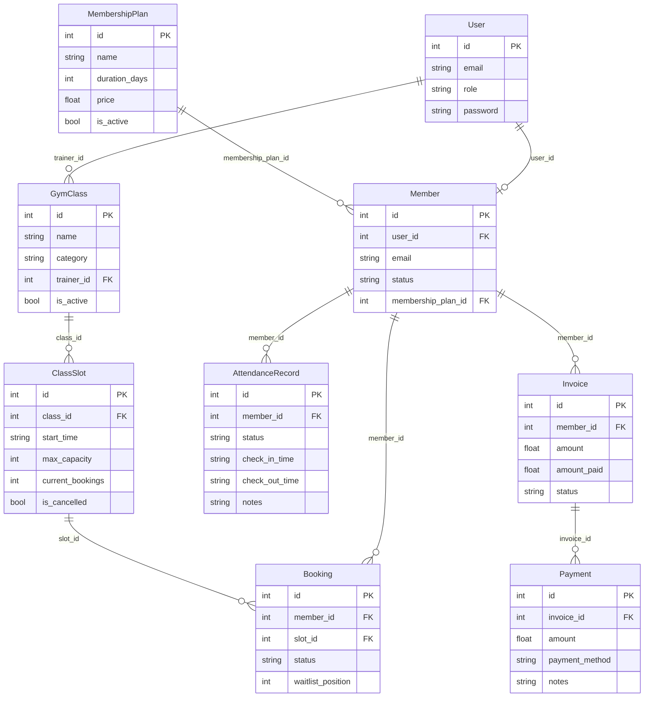

# Gym Models — Project Architecture & Context

## 1. Project Overview
A lightweight gym management system prototype structured with **FastAPI** and **Pydantic**, following the simplified "books.py" tutorial pattern. 
Currently, the codebase consists of 9 standalone microservice-style Python modules using in-memory Python lists for data persistence and mock data.

---

## 2. File & Service Directory

| Module | Primary Class / Request | Port | Responsibilities | Filter Endpoint |
|---|---|---|---|---|
| [`users.py`](./users.py) | `User` / `UserRequest` | 8001 | User accounts (Admin, Trainer, Member) & auth credentials | `GET /users/get_role?role=...` |
| [`membership_plans.py`](./membership_plans.py) | `MembershipPlan` / `MembershipPlanRequest` | 8002 | Membership packages (pricing, duration in days, active status) | `GET /membership_plans/get_by_duration?duration_days=...` |
| [`members.py`](./members.py) | `Member` / `MemberRequest` | 8003 | Gym member profiles linked to user and current plan | `GET /members/get_by_status?status=...` |
| [`gym_classes.py`](./gym_classes.py) | `GymClass` / `GymClassRequest` | 8004 | Workout classes (Yoga, Boxing, HIIT, etc.) assigned to trainers | `GET /gym_classes/get_by_category?category=...` |
| [`class_slots.py`](./class_slots.py) | `ClassSlot` / `ClassSlotRequest` | 8005 | Class schedule slots, capacity limits, live booking counts | `GET /class_slots/get_by_class?class_id=...` |
| [`bookings.py`](./bookings.py) | `Booking` / `BookingRequest` | 8006 | Class seat reservations and waitlist positions | `GET /bookings/get_by_status?status=...` |
| [`invoices.py`](./invoices.py) | `Invoice` / `InvoiceRequest` | 8007 | Billing records for membership plans with payment tracking | `GET /invoices/get_by_status?status=...` |
| [`payments.py`](./payments.py) | `Payment` / `PaymentRequest` | 8008 | Transactions tied to invoices (cash, bank transfer, card) | `GET /payments/get_by_method?method=...` |
| [`attendance.py`](./attendance.py) | `AttendanceRecord` / `AttendanceRecordRequest` | 8009 | Facility check-in / check-out timestamps and logs | `GET /attendance/get_by_status?status=...` |

---

## 3. Data Model Relationships

---

## 4. Uniform Code Pattern Across All Modules

Each file implements a consistent 4-layer structure:

1. **Native Python Class**:
   - Contains `__init__` constructor initializing attributes.
2. **Pydantic Validation Model (`*Request`)**:
   - `id: Optional[int] = Field(default=None, title="id is not needed")`
   - Specific range/length constraints using `Field(gt=..., lt=..., min_length=..., max_length=...)`
   - Inner `Config` class with `json_schema_extra` providing OpenAPI/Swagger `/docs` examples.
3. **In-Memory Storage List**:
   - Global list initialized with 3-4 seed data objects.
4. **CRUD REST Endpoints**:
   - `GET /`: Service name & status
   - `GET /<plural>`: Fetch all records
   - `GET /<plural>/get_<condition>`: Filter items (case-insensitive via `.casefold()`)
   - `GET /<plural>/{id}`: Single item lookup
   - `POST /<singular>/create_<singular>`: Auto-increment ID via helper `find_<entity>_id` and append
   - `PUT /<singular>/update_<singular>`: In-place index replacement
   - `DELETE /<plural>/delete_<singular>/{id}`: Pop by ID match

---

## 5. Roadmap & Technical Debt

1. **Persistence Migration**: Migrate in-memory Python lists to SQLite/PostgreSQL with SQLAlchemy/SQLModel.
2. **App Consolidation**: Merge standalone micro-apps into a unified FastAPI application using `APIRouter`.
3. **HTTP Status & Error Responses**: Standardize 201/204 codes and 404/400 `HTTPException` handlers.
4. **Security & Auth**: Replace plain text passwords in `users.py` with bcrypt hashing & JWT tokens.
5. **Business Logic & Relations**: Enforce foreign key validation, slot capacity boundaries, and ISO `datetime` types.
