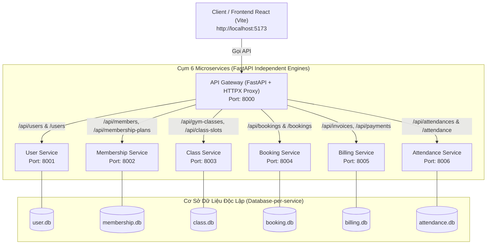

# Kiến Trúc Microservices Hệ Thống Quản Lý Gym (SOA)

- **Ngày tạo:** 2026-10-18
- **Dự án:** SOA Gym Management (Hệ thống hướng dịch vụ)
- **Công nghệ chính:** FastAPI, SQLite, SQLAlchemy, Pydantic, HTTPX, Uvicorn, React + Vite

---

## 1. Tổng Quan & Mục Tiêu

Hệ thống quản trị phòng tập Gym đang được triển khai dưới dạng một ứng dụng Monolithic duy nhất (`gym-models/main.py`) với 9 models ORM và 1 file CSDL SQLite tập trung (`gym.db`). 

Mục tiêu của dự án là tái cấu trúc (refactor) toàn bộ backend thành kiến trúc **Microservices chuẩn mực** với:
1. **6 Microservices độc lập** theo nguyên tắc *Share-Nothing* (mỗi service tự quản lý schema, models, schemas và cơ sở dữ liệu SQLite riêng).
2. **1 API Gateway tập trung** đóng vai trò là điểm giao tiếp duy nhất (Single Entry Point) cho client và Frontend.
3. **Chuẩn hóa danh mục RESTful Endpoints** theo tiền tố `/api/...` (bỏ qua phiên bản `/v1` theo yêu cầu), đồng thời hỗ trợ song song các route tương thích ngược (Legacy Routes) để Frontend React hiện tại hoạt động liền mạch mà không cần can thiệp mã nguồn.
4. **Bảo toàn 100% logic nghiệp vụ**: Duy trì trọn vẹn các cấu trúc ràng buộc dữ liệu (Pydantic validation schemas), các phương thức CRUD, và dữ liệu mẫu khởi tạo ban đầu (seed data).

---

## 2. Sơ Đồ Kiến Trúc Hệ Thống (Architecture Diagram)



---

## 3. Cấu Trúc Thư Mục Chi Tiết

Toàn bộ backend sẽ được tổ chức lại trong cấu trúc:

```text
soa-gym-gk/
├── frontend/                     # Ứng dụng Frontend React hiện có
│   └── src/services/api.js       # Gọi vào http://127.0.0.1:8000
├── gym-models/                   # Thư mục gốc Backend Microservices
│   ├── api-gateway/              # Module API Gateway (Port 8000)
│   │   ├── main.py               # Reverse Proxy, CORS, Health Check, Route Mapping
│   │   └── config.py             # Cấu hình địa chỉ và cổng của 6 services
│   ├── services/
│   │   ├── user-service/         # Port 8001 (user.db)
│   │   │   ├── database.py       # Kết nối SQLite riêng
│   │   │   ├── models.py         # ORM User
│   │   │   ├── schemas.py        # User_Request validation
│   │   │   └── main.py           # CRUD + Seed data
│   │   ├── membership-service/   # Port 8002 (membership.db)
│   │   │   ├── database.py
│   │   │   ├── models.py         # Member, MembershipPlan
│   │   │   ├── schemas.py        # Member_Request, MembershipPlan_Request
│   │   │   └── main.py           # CRUD + Seed data
│   │   ├── class-service/        # Port 8003 (class.db)
│   │   │   ├── database.py
│   │   │   ├── models.py         # GymClass, ClassSlot
│   │   │   ├── schemas.py        # GymClass_Request, ClassSlot_Request
│   │   │   └── main.py           # CRUD + Seed data
│   │   ├── booking-service/      # Port 8004 (booking.db)
│   │   │   ├── database.py
│   │   │   ├── models.py         # Booking
│   │   │   ├── schemas.py        # Booking_Request
│   │   │   └── main.py           # CRUD + Seed data
│   │   ├── billing-service/      # Port 8005 (billing.db)
│   │   │   ├── database.py
│   │   │   ├── models.py         # Invoice, Payment
│   │   │   ├── schemas.py        # Invoice_Request, Payment_Request
│   │   │   └── main.py           # CRUD + Seed data
│   │   └── attendance-service/   # Port 8006 (attendance.db)
│   │       ├── database.py
│   │       ├── models.py         # AttendanceRecord
│   │       ├── schemas.py        # Attendance_Request
│   │       └── main.py           # CRUD + Seed data
│   ├── run_all.py                # Script Python chạy đa tiến trình cho toàn bộ hệ thống
│   ├── run_all.bat               # Script Windows Batch khởi chạy 1-click
│   └── requirements.txt          # fastapi, uvicorn, sqlalchemy, httpx, pydantic
```

---

## 4. Chi Tiết Các Microservices

### 4.1. `user-service` (Port 8001)
- **Cơ sở dữ liệu:** `user.db`
- **Models:**
  - `User`: `id` (int, PK), `email` (str, unique), `role` (str), `password` (str), `is_active` (bool)
- **Schemas:** `User_Request`
- **Endpoints:**
  - `GET /users` & `GET /users/{id}`
  - `POST /users`
  - `PUT /users/{id}`
  - `DELETE /users/{id}`
- **Dữ liệu mẫu ban đầu:** 3 users (`admin@gym.com`, `trainer.nam@gym.com`, `member.an@gym.com`).

### 4.2. `membership-service` (Port 8002)
- **Cơ sở dữ liệu:** `membership.db`
- **Models:**
  - `MembershipPlan`: `id`, `name`, `duration_days`, `price`, `is_active`
  - `Member`: `id`, `user_id`, `full_name`, `email`, `status`, `membership_plan_id`
- **Schemas:** `MembershipPlan_Request`, `Member_Request`
- **Endpoints:**
  - `GET|POST /membership-plans`, `GET|PUT|DELETE /membership-plans/{id}`
  - `GET|POST /members`, `GET|PUT|DELETE /members/{id}`
- **Dữ liệu mẫu ban đầu:** 3 gói tập mẫu và 1 hội viên mẫu.

### 4.3. `class-service` (Port 8003)
- **Cơ sở dữ liệu:** `class.db`
- **Models:**
  - `GymClass`: `id`, `name`, `category`, `trainer_id`, `is_active`
  - `ClassSlot`: `id`, `class_id`, `start_time`, `max_capacity`, `current_bookings`, `is_cancelled`
- **Schemas:** `GymClass_Request`, `ClassSlot_Request`
- **Endpoints:**
  - `GET|POST /gym-classes`, `GET|PUT|DELETE /gym-classes/{id}`
  - `GET|POST /class-slots`, `GET|PUT|DELETE /class-slots/{id}`
- **Dữ liệu mẫu ban đầu:** 2 lớp tập ("Yoga Binh Minh", "Boxing Doi Khang") và 1 khung giờ slot mẫu.

### 4.4. `booking-service` (Port 8004)
- **Cơ sở dữ liệu:** `booking.db`
- **Models:**
  - `Booking`: `id`, `member_id`, `slot_id`, `status`, `waitlist_position`
- **Schemas:** `Booking_Request`
- **Endpoints:**
  - `GET|POST /bookings`, `GET|PUT|DELETE /bookings/{id}`
- **Dữ liệu mẫu ban đầu:** 1 lượt đặt chỗ cho `member_id=1`, `slot_id=1`.

### 4.5. `billing-service` (Port 8005)
- **Cơ sở dữ liệu:** `billing.db`
- **Models:**
  - `Invoice`: `id`, `member_id`, `amount`, `amount_paid`, `status`
  - `Payment`: `id`, `invoice_id`, `amount`, `payment_method`, `notes`
- **Schemas:** `Invoice_Request`, `Payment_Request`
- **Endpoints:**
  - `GET|POST /invoices`, `GET|PUT|DELETE /invoices/{id}`
  - `GET|POST /payments`, `GET|PUT|DELETE /payments/{id}`
- **Dữ liệu mẫu ban đầu:** 2 hóa đơn mẫu và 1 khoản thanh toán chuyển khoản mẫu.

### 4.6. `attendance-service` (Port 8006)
- **Cơ sở dữ liệu:** `attendance.db`
- **Models:**
  - `AttendanceRecord`: `id`, `member_id`, `status`, `check_in_time`, `check_out_time`, `notes`
- **Schemas:** `Attendance_Request`
- **Endpoints:**
  - `GET|POST /attendance`, `GET|PUT|DELETE /attendance/{id}`
- **Dữ liệu mẫu ban đầu:** 1 bản ghi điểm danh mẫu (`checked_in`).

---

## 5. Đặc Tả API Gateway (Port 8000)

### 5.1. Bảng ánh xạ Endpoint (Routing Table)

API Gateway tiếp nhận request từ Client tại port 8000 và forward tới microservice đích theo bảng sau:

| Chuẩn RESTful Gateway (`/api/...`) | Tương thích cũ (`Legacy Alias`) | Service đích | HTTP Methods |
| :--- | :--- | :--- | :--- |
| `/api/users` & `/api/users/{id}` | `/users` & `/users/{id}` | `http://127.0.0.1:8001/users...` | GET, POST, PUT, DELETE |
| `/api/membership-plans` & `{id}` | `/membership-plans` & `{id}` | `http://127.0.0.1:8002/membership-plans...` | GET, POST, PUT, DELETE |
| `/api/members` & `/api/members/{id}` | `/members` & `/members/{id}` | `http://127.0.0.1:8002/members...` | GET, POST, PUT, DELETE |
| `/api/gym-classes` & `{id}` | `/gym-classes` & `{id}` | `http://127.0.0.1:8003/gym-classes...` | GET, POST, PUT, DELETE |
| `/api/class-slots` & `{id}` | `/class-slots` & `{id}` | `http://127.0.0.1:8003/class-slots...` | GET, POST, PUT, DELETE |
| `/api/bookings` & `/api/bookings/{id}` | `/bookings` & `/bookings/{id}` | `http://127.0.0.1:8004/bookings...` | GET, POST, PUT, DELETE |
| `/api/invoices` & `/api/invoices/{id}` | `/invoices` & `/invoices/{id}` | `http://127.0.0.1:8005/invoices...` | GET, POST, PUT, DELETE |
| `/api/payments` & `/api/payments/{id}` | `/payments` & `/payments/{id}` | `http://127.0.0.1:8005/payments...` | GET, POST, PUT, DELETE |
| `/api/attendances` & `{id}` | `/attendance` & `{id}` | `http://127.0.0.1:8006/attendance...` | GET, POST, PUT, DELETE |

### 5.2. Nguyên lý hoạt động của Gateway:
- **Async HTTP Streaming / Forwarding:** Sử dụng `httpx.AsyncClient` tái sử dụng connection pool. Chuyển tiếp toàn bộ URL parameters, request body JSON, và headers.
- **Tự động xử lý trailing slash:** Xử lý linh hoạt cả trường hợp Frontend gọi `/users/` lẫn `/users`.
- **CORS Configuration:** Cung cấp CORS middleware tại gateway cho phép mọi origin truy cập.
- **Xử lý sự cố (Fault Handling):** Nếu dịch vụ đích không thể kết nối được (`httpx.ConnectError`), Gateway trả về mã HTTP `503 Service Unavailable` với thông báo lỗi rõ ràng.
- **Health Check:** `GET /health` trả về trạng thái của Gateway và trạng thái kết nối tới 6 microservices.

---

## 6. Cơ Chế Khởi Chạy & Vận Hành Hệ Thống

Để thuận tiện chạy toàn bộ hệ sinh thái trên Windows mà không cần mở 7 cửa sổ dòng lệnh thủ công:
1. **`run_all.py`**:
   - Sử dụng `subprocess.Popen` khởi chạy lần lượt 6 services (ports 8001–8006) và 1 gateway (port 8000).
   - In thông báo màu/trạng thái khởi động rõ ràng trên terminal.
   - Bắt tín hiệu ngắt `SIGINT` (`Ctrl+C`): Duyệt và đóng (terminate / kill) toàn bộ 7 tiến trình con an toàn.
2. **`run_all.bat`**:
   - File batch cho Windows, người dùng có thể nhấp đúp hoặc gõ `.\run_all.bat` trong terminal là hệ thống tự khởi chạy.

---

## 7. Kế Hoạch Kiểm Thử & Nghiệm Thu (Verification Plan)

1. **Khởi động:** Thực thi `python run_all.py`, kiểm tra terminal xác nhận 7 tiến trình đều đã sẵn sàng.
2. **Kiểm tra cơ sở dữ liệu:** Xác nhận 6 file `.db` riêng lẻ (`user.db`, `membership.db`, ...) được tự động khởi tạo trong thư mục của từng service.
3. **Kiểm tra Health & Swagger:**
   - Truy cập `http://127.0.0.1:8000/docs` (Swagger UI Gateway).
   - Truy cập `http://127.0.0.1:8000/health` xác nhận 6 microservice phản hồi `UP`.
4. **Kiểm tra tương thích Frontend:**
   - Mở giao diện Frontend tại `http://localhost:5173`.
   - Kiểm tra hiển thị dữ liệu và thao tác thêm/sửa/xóa trên toàn bộ 9 màn hình: Users, Members, Plans, Classes, Slots, Bookings, Invoices, Payments, Attendance.
